# Blue-Green Deployment Strategy on AWS

**Region:** US East (Ohio), `us-east-2`  |  **Author:** Oliver Moosberger  |  **Repo:** [olivermooz-117/bg-scripts](https://github.com/olivermooz-117/bg-scripts)

## Table of Contents

- [Blue-Green Deployment Strategy on AWS](#blue-green-deployment-strategy-on-aws)
  - [Table of Contents](#table-of-contents)
  - [1. Project Overview](#1-project-overview)
  - [2. Architecture](#2-architecture)
  - [3. Repository Contents](#3-repository-contents)
  - [4. Environment Build](#4-environment-build)
  - [5. Traffic Switching](#5-traffic-switching)
  - [6. Validation and Traffic Test Results](#6-validation-and-traffic-test-results)
  - [7. Failure Simulation](#7-failure-simulation)
  - [8. Manual Rollback and Recovery](#8-manual-rollback-and-recovery)
  - [9. CloudWatch Monitoring and SNS Notifications](#9-cloudwatch-monitoring-and-sns-notifications)
  - [10. Automated Rollback with Lambda](#10-automated-rollback-with-lambda)
  - [11. Manual Rollback Runbook](#11-manual-rollback-runbook)
  - [12. Results and Lessons Learned](#12-results-and-lessons-learned)
  - [13. Limitations and Future Improvements](#13-limitations-and-future-improvements)
  - [14. Cleanup](#14-cleanup)

## 1. Project Overview

This project implements a Blue-Green deployment strategy for a web application on Amazon EC2 behind an Application Load Balancer (ALB). Two identical environments, Blue (current) and Green (new), run side by side. Traffic is shifted between them with weighted target groups, so a release can be validated on a small share of users and reversed in seconds.

It uses EC2, an ALB with weighted forwarding, AWS CLI and Bash automation, CloudWatch alarms, SNS email notifications and a Lambda rollback function.

What was demonstrated:

- Staged traffic shifting: 90/10, 50/50 and 0/100.
- Health-gated switching: the script refuses to send traffic to an unhealthy target group.
- Per-request verification using the `X-Environment` response header.
- A deliberate HTTP 500 failure on Green, detected by CloudWatch.
- Manual rollback to Blue and recovery validation.
- A Lambda function that rolls back to Blue when the `bg-green-5xx` alarm fires.

## 2. Architecture


```text
                         Users
                           |
                           v
              Application Load Balancer (bg-alb)
                  HTTP :80, weighted forwarding
                   |                       |
            weight (Blue)            weight (Green)
                   v                       v
         bg-blue-tg (Blue EC2)     bg-green-tg (Green EC2)
          us-east-2a, v1            us-east-2b, v2

Monitoring and automation:
CloudWatch alarms --> SNS topic (bg-deploy-alerts) --+--> Email notification
                                                     +--> Lambda (bg-auto-rollback)
                                                              |
                                                              v
                                                   ALB listener: Blue 100 / Green 0
```

| Component | Name / detail |
|---|---|
| Application Load Balancer | `bg-alb` (HTTP 80) |
| Blue target group / instance | `bg-blue-tg`, serves `X-Environment: BLUE`, version 1 |
| Green target group / instance | `bg-green-tg`, serves `X-Environment: GREEN`, version 2 |
| Security group | `bg-web-sg` |
| SNS topic | `bg-deploy-alerts` (email subscription confirmed, Lambda subscription) |
| Lambda | `bg-auto-rollback` (Python, boto3) |
| CloudWatch alarms | `bg-green-5xx`, `bg-green-unhealthy-hosts`, `bg-blue-unhealthy-hosts`, `bg-alb-high-latency` |

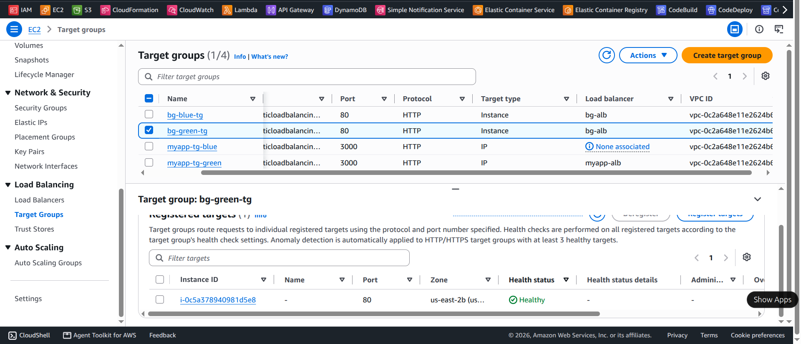

*Both target groups registered with the load balancer.*

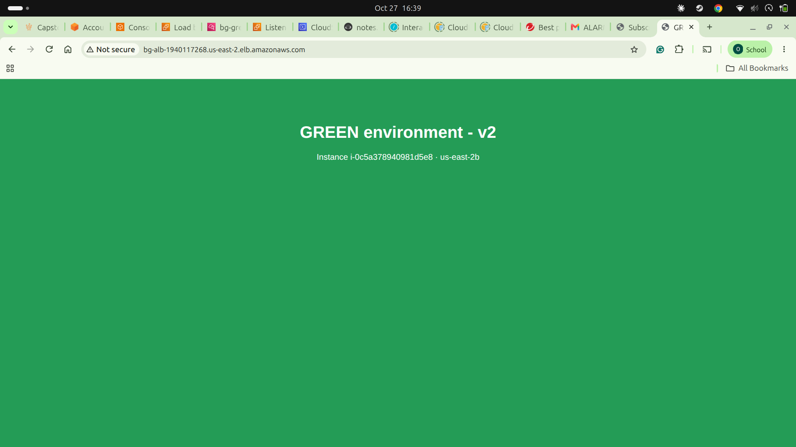

*The Green environment (version 2) served through the ALB.*

## 3. Repository Contents

| File | Description |
|---|---|
| `README.md` | Documentation, test results and procedures. |
| `switch-traffic.sh` | Sets the Blue/Green listener weights. Checks target health first, then logs the change. |
| `traffic-test.sh` | Sends requests through the ALB and counts responses by `X-Environment`. |
| `rollback.sh` | Returns all traffic to Blue (100/0). Bypasses the health gate with `SKIP_HEALTH_CHECK=1`. |
| `lambda_function.py` | Source of the `bg-auto-rollback` Lambda function. |
| `switch.log` | Timestamped record of every traffic change. |
| `mermaid-diagram.svg` | Architecture diagram. |
| `docs/` | Evidence screenshots. |

## 4. Environment Build

1. **Security group `bg-web-sg`:** inbound HTTP 80 from anywhere (ALB and instances) and SSH 22 from my IP only.
2. **Two EC2 instances** (Amazon Linux 2023, `t3.micro`) in different Availability Zones. Each is launched with this user-data, changing only the environment name and version:

```bash
#!/bin/bash
dnf install -y httpd
systemctl enable --now httpd
ENV=BLUE; VER=1          # GREEN / 2 on the second instance
echo "<h1>${ENV} environment - version ${VER}</h1>" > /var/www/html/index.html
echo "ok" > /var/www/html/health
cat > /etc/httpd/conf.d/headers.conf <<EOF
Header always set X-Environment "${ENV}"
Header always set X-App-Version "${VER}"
EOF
systemctl restart httpd
```

3. **Target groups** `bg-blue-tg` and `bg-green-tg` (HTTP 80, health check path `/health`). One instance is registered in each.
4. **Application Load Balancer** `bg-alb` (internet-facing, HTTP 80) with a listener that forwards to both target groups using weights.
5. **Verification:** both target groups report `healthy`, and `curl -I` against the ALB returns the `X-Environment` header.

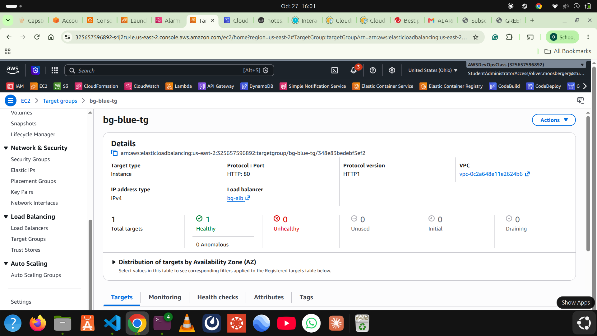

*Blue target group with a healthy registered target.*

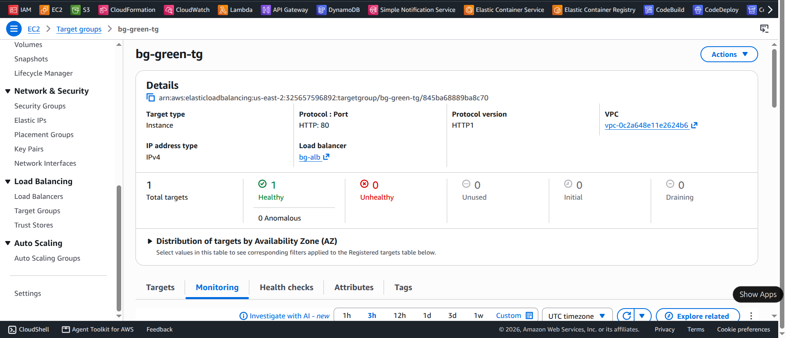

*Green target group with a healthy registered target.*

## 5. Traffic Switching

`switch-traffic.sh <blue_weight> <green_weight>` changes the ALB listener weights.

```bash
./switch-traffic.sh 90 10     # canary: 90% Blue, 10% Green
./switch-traffic.sh 50 50     # even split
./switch-traffic.sh 0 100     # full cutover to Green
./switch-traffic.sh 100 0     # back to Blue
```

How it works:

- It looks up the ALB, listener and target-group ARNs with the AWS CLI.
- **Health gate:** it checks every target group with a non-zero weight and aborts if any target is unhealthy (override only with `SKIP_HEALTH_CHECK=1`).
- It applies the weights with `modify-listener` and appends the weights and a UTC timestamp to `switch.log`.

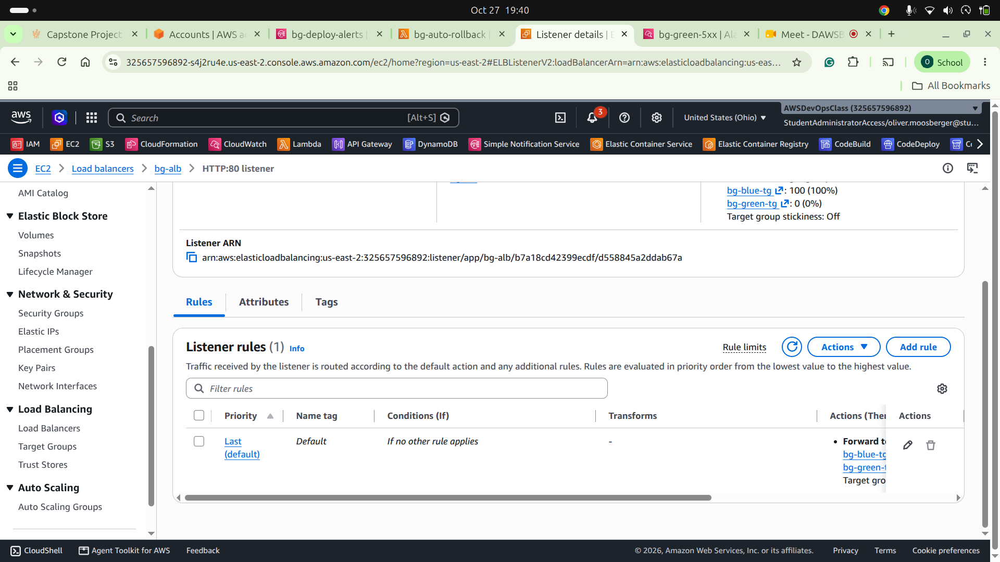

*ALB listener forwarding rule with the two target groups.*

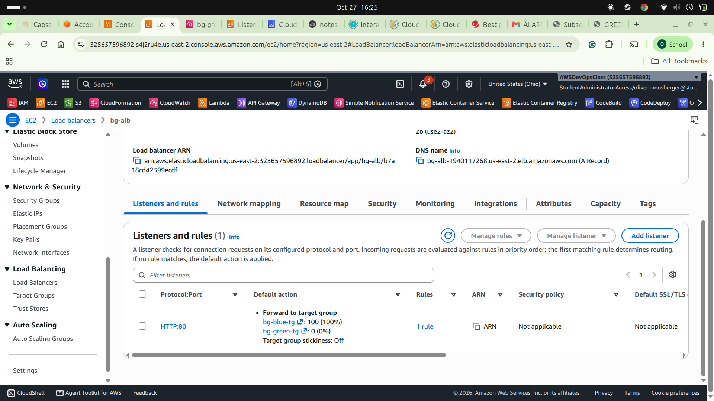

*Weighted forwarding configuration.*

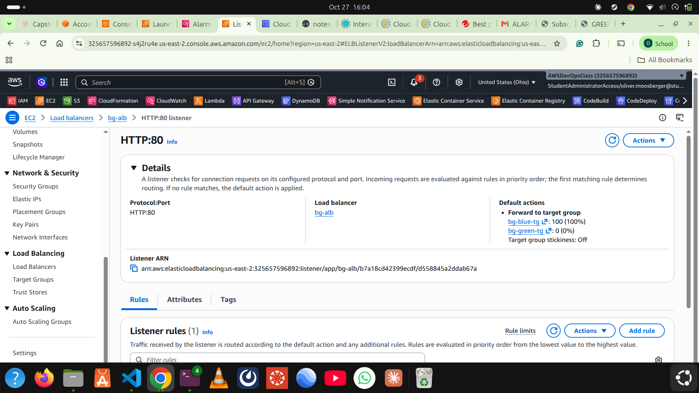

*Listener weights after a switch.*

## 6. Validation and Traffic Test Results

`traffic-test.sh <n>` sends `n` requests to the ALB and counts the `X-Environment` header in each response.

| Configuration | Requests | Blue | Green | Observation |
|---|---:|---:|---:|---|
| 90 / 10 | 200 | 184 | 16 | 92% / 8%, close to the configured split |
| 50 / 50 | 40 | 26 | 14 | Both environments served traffic |
| 0 / 100 (full cutover) | 20 | 0 | 20 | All requests reached Green |
| Rollback to 100% Blue | 20 | 20 | 0 | All requests reached Blue |

Notes:

- Weighted routing is probabilistic, so small samples do not match the configured weights exactly. An earlier 90/10 run of 40 requests returned no Green responses; I did not treat it as proof and repeated the test with 200 requests.
- Right after a weight change the ALB can take a few seconds to propagate. I wait about 30 seconds before measuring.
- The listener weights were checked with `aws elbv2 describe-rules` / `describe-listeners` and matched the configured values.

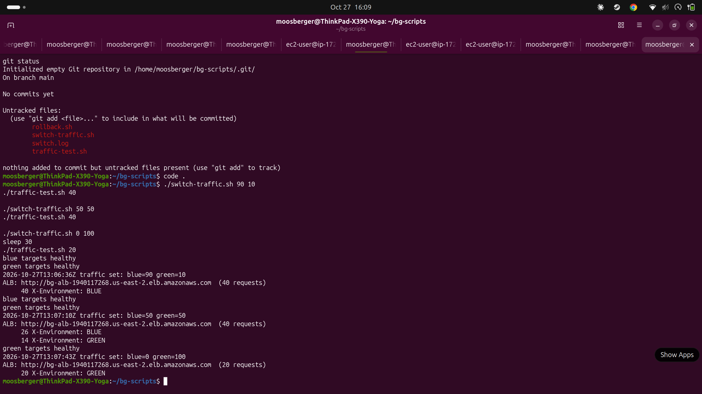

*Request counts per environment for each stage.*

## 7. Failure Simulation

To test detection and rollback, a fault was injected on the **Green** instance while it was receiving traffic. A temporary Apache rule makes every request return HTTP 500:

```bash
printf 'RewriteEngine On\nRewriteRule ^ - [R=500,L]\n' | sudo tee /etc/httpd/conf.d/fault.conf
sudo systemctl reload httpd
curl -s -o /dev/null -w '%{http_code}\n' http://localhost/     # 500
```

With Green receiving all traffic, 20 requests through the ALB returned 20 × HTTP 500. The resulting target 5XX errors drive the `bg-green-5xx` alarm (section 9).

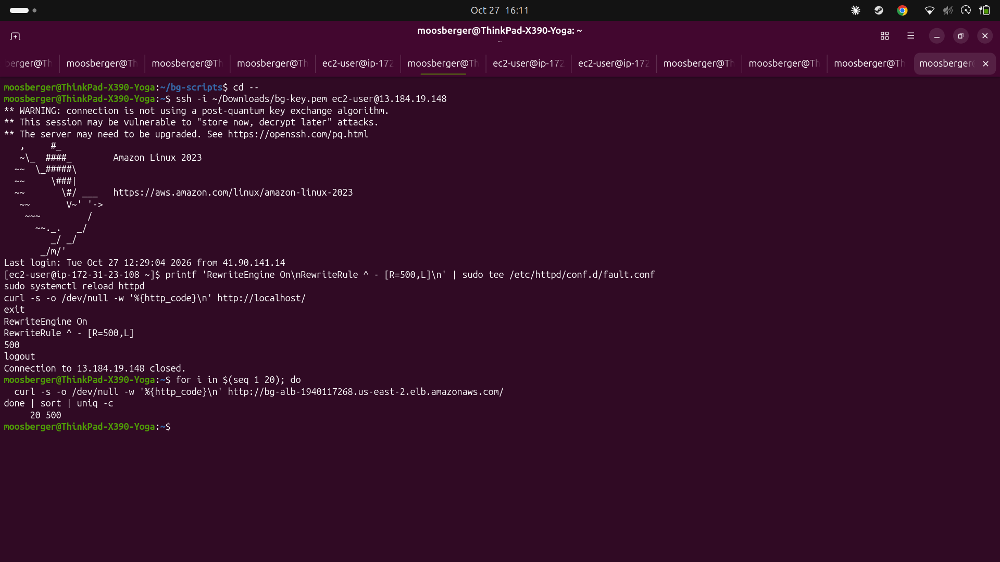

*HTTP 500 on the Green instance and 20 of 20 failed requests through the ALB.*

## 8. Manual Rollback and Recovery

Rollback is a traffic change, not an application repair, so there are two steps.

1. **Restore traffic to Blue:**

```bash
cd ~/bg-scripts
./rollback.sh          # equivalent to: SKIP_HEALTH_CHECK=1 ./switch-traffic.sh 100 0
```

Rollback skips the health gate on purpose, so it works even if a target is flapping. Use it knowing Blue must be healthy. One recorded rollback took about 7.6 seconds.

2. **Repair Green** (remove the injected fault):

```bash
sudo rm -f /etc/httpd/conf.d/fault.conf
sudo systemctl reload httpd
curl -s -o /dev/null -w '%{http_code}\n' http://localhost/     # 200
```

3. **Verify:** `./traffic-test.sh 20` returned 20 of 20 `X-Environment: BLUE` responses.

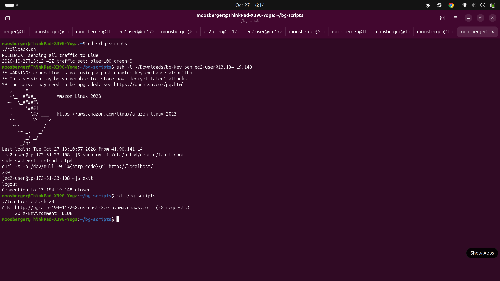

*Rollback to Blue, Green fault removed (HTTP 200), and 20 of 20 requests served by Blue.*

**Final state:** after testing, the listener was set back to Blue 100% / Green 0% (last entry in `switch.log`).

## 9. CloudWatch Monitoring and SNS Notifications

| Alarm | Metric (`AWS/ApplicationELB`) | Condition |
|---|---|---|
| `bg-green-5xx` | `HTTPCode_Target_5XX_Count` (Green target group) | Sum >= 5 in 1 minute |
| `bg-green-unhealthy-hosts` | `UnHealthyHostCount` (Green) | >= 1 for 2 of 2 minutes |
| `bg-blue-unhealthy-hosts` | `UnHealthyHostCount` (Blue) | >= 1 for 2 of 2 minutes |
| `bg-alb-high-latency` | `TargetResponseTime` | > 1 second for 3 of 3 minutes |

All alarms use `treat missing data = notBreaching` and send to the SNS topic `bg-deploy-alerts`. During the failure test, `bg-green-5xx` and `bg-green-unhealthy-hosts` went to `ALARM`; the latency and Blue alarms stayed `OK`.

The alarm history shows the SNS notification action executing successfully on 27 October 2026 at 13:14:54 UTC, and the email subscription is confirmed.

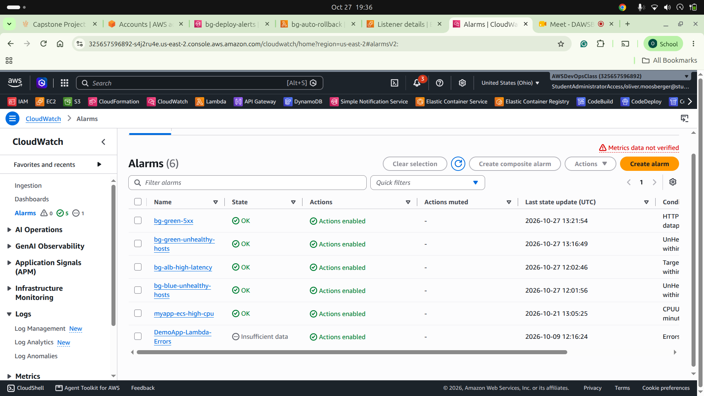

*The four alarms and their states.*

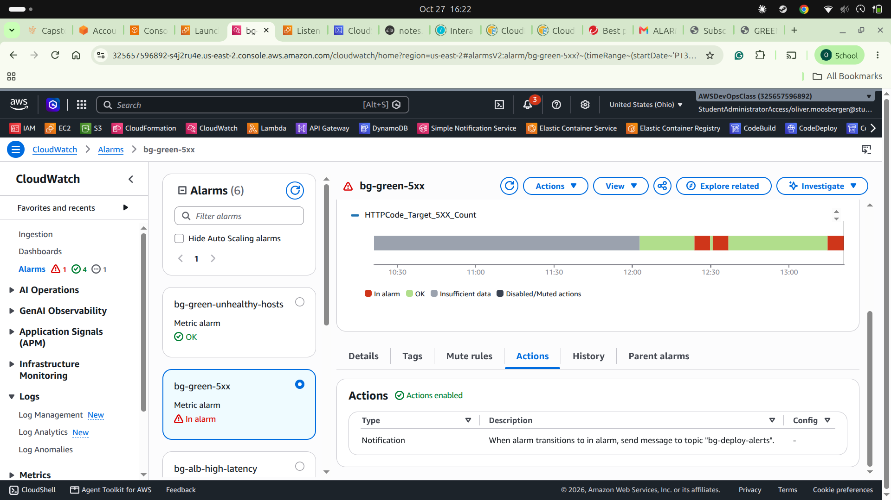

*Alarm actions publishing to `bg-deploy-alerts`.*

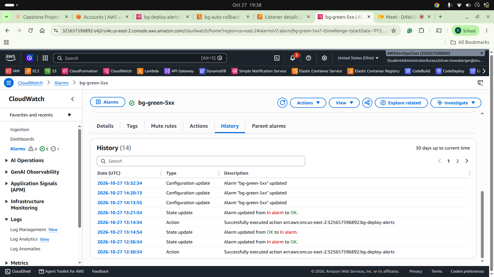

*Alarm notification evidence.*

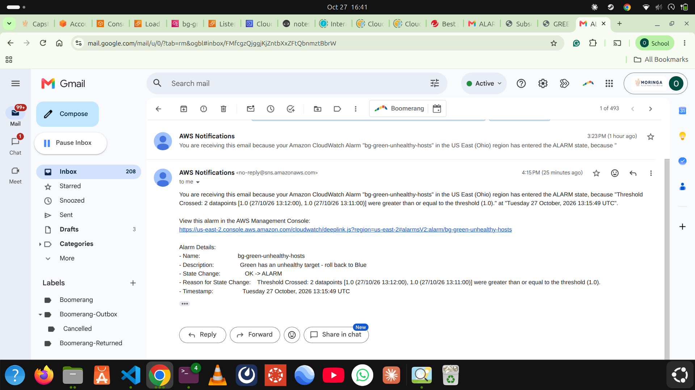

*SNS topic and subscription.*

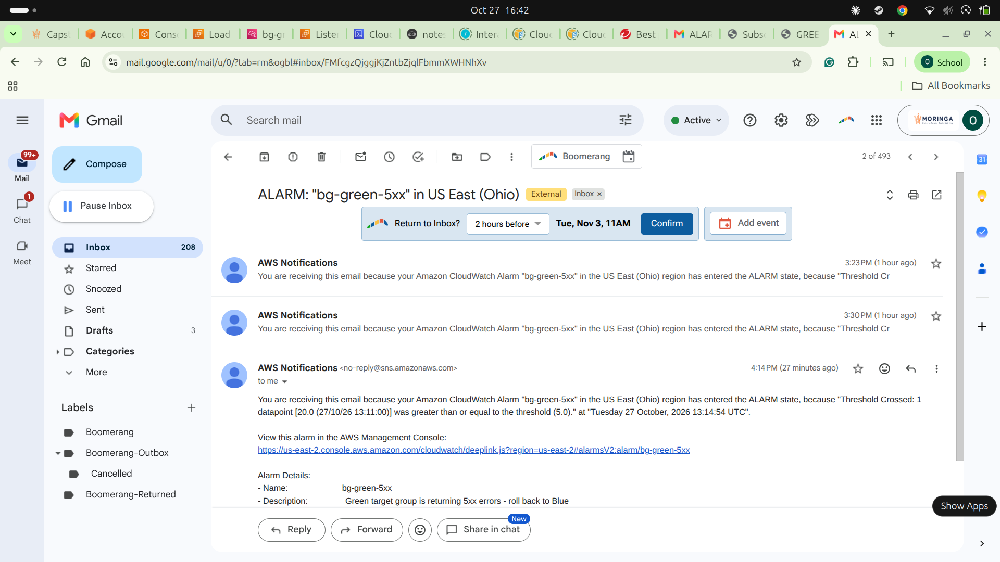

*Notification delivered by SNS.*

## 10. Automated Rollback with Lambda

`lambda_function.py` is deployed as `bg-auto-rollback`. It automates the same rollback as `rollback.sh`.

**Trigger wiring:** the function is subscribed to the SNS topic `bg-deploy-alerts`, and SNS is permitted to invoke it:

```bash
aws lambda add-permission --function-name bg-auto-rollback --statement-id sns-invoke \
  --action lambda:InvokeFunction --principal sns.amazonaws.com --source-arn "$TOPIC_ARN"
aws sns subscribe --topic-arn "$TOPIC_ARN" --protocol lambda --notification-endpoint "$FN_ARN"
```

**Flow:** `bg-green-5xx` enters `ALARM` -> CloudWatch publishes to `bg-deploy-alerts` -> SNS invokes the Lambda (and emails me) -> the Lambda moves the listener to Blue 100 / Green 0.

**Logic and safeguards:**

1. Accepts either a direct alarm event or an SNS record (parses the JSON message).
2. Ignores everything except alarm `bg-green-5xx` in state `ALARM`, so other alarms cannot trigger a rollback.
3. Looks up `bg-alb` and confirms both target groups belong to it.
4. **Refuses to roll back if Blue has no registered targets or any Blue target is unhealthy**, so it never moves traffic to a broken environment.
5. Calls `modify_listener` on the HTTP:80 listener with Blue weight 100 and Green weight 0.

**Permissions:** the execution role allows `elasticloadbalancing:DescribeLoadBalancers`, `DescribeTargetGroups`, `DescribeListeners`, `DescribeTargetHealth` and `ModifyListener`, plus CloudWatch Logs write access.

**Test:** the function was invoked with a controlled alarm event:

```json
{
  "AlarmName": "bg-green-5xx",
  "NewStateValue": "ALARM",
  "OldStateValue": "OK",
  "NewStateReason": "Controlled test of automatic rollback",
  "Region": "US East (Ohio)"
}
```

Result in CloudWatch Logs: `AUTOMATIC ROLLBACK SUCCESS: Blue=100%, Green=0%`, and the listener showed Blue 100 / Green 0.

**Current status:** the rollback logic is tested with a controlled event, and the SNS-to-Lambda trigger is configured. An alarm-driven run is the next test: shift to 50/50, inject the fault on Green, and confirm that the alarm, the Lambda invocation and the final listener state line up in the logs.

## 11. Manual Rollback Runbook

1. Check target health (EC2 console or `aws elbv2 describe-target-health`).
2. Review the CloudWatch alarms and application logs.
3. Run `./rollback.sh`.
4. Confirm the listener weights are Blue `100` / Green `0`.
5. Fix the faulty instance separately.
6. Run `./traffic-test.sh 20` and confirm all responses come from Blue with HTTP 200.
7. Investigate and revalidate Green before the next deployment.

## 12. Results and Lessons Learned

- Weighted forwarding allows safe, staged releases: 10%, then 50%, then 100%.
- A health gate in the switch script prevents sending traffic to an unhealthy environment.
- The `X-Environment` header makes routing verifiable per request, not assumed.
- ALB weight changes take a few seconds to propagate, and small samples vary, so tests need a wait and a larger sample.
- Rolling back traffic and repairing the application are separate steps.
- Automation needs guardrails: the Lambda checks that Blue is healthy before it acts.

## 13. Limitations and Future Improvements

- Single instance per environment; production would use Auto Scaling groups per target group.
- HTTP only; production would terminate HTTPS with an ACM certificate.
- Add smoke tests before each shift and larger sample sizes.
- Gradual automated shifting (for example 10, 25, 50, 100) with automatic rollback at each step.
- Manage the infrastructure with CloudFormation or Terraform.

## 14. Cleanup

After grading, remove the ALB, both target groups, both EC2 instances, the security group, the Lambda function, the CloudWatch alarms, the SNS topic and the key pair to avoid charges.